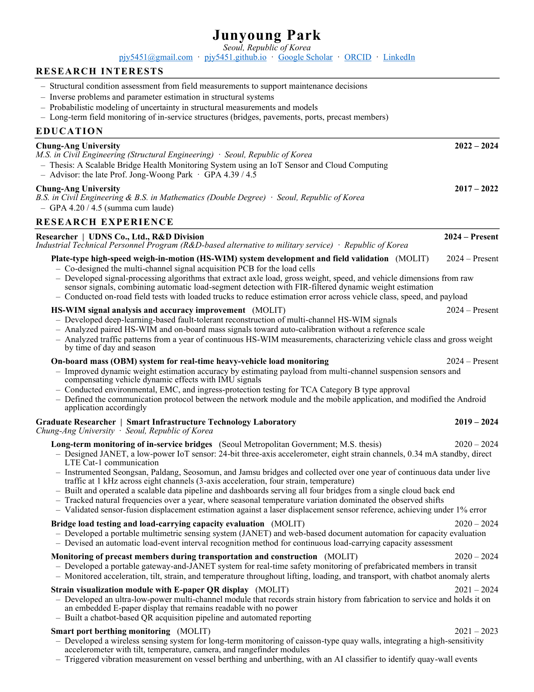
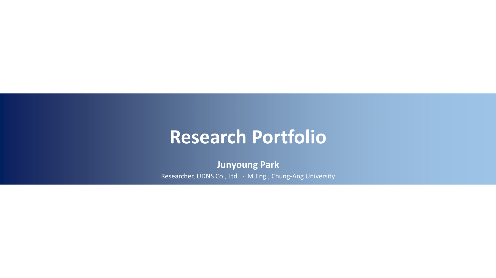

<header class="cv-simple-header">
  <h1>CV</h1>
  

    

      <button class="cv-simple-download" type="button" aria-expanded="false" aria-controls="cv-preview" data-document-toggle data-open-label="View CV" data-close-label="Hide CV">
        <svg viewBox="0 0 24 24" aria-hidden="true"><path d="M12 3v12"></path><path d="m7.5 10.5 4.5 4.5 4.5-4.5"></path><path d="M5 20h14"></path></svg>
        View CV
      </button>
      Updated Nov 2026
    

    

      <button class="cv-portfolio-toggle" type="button" aria-expanded="false" aria-controls="portfolio-preview" data-document-toggle data-open-label="View Portfolio" data-close-label="Hide Portfolio">
        <svg viewBox="0 0 24 24" aria-hidden="true"><path d="M3 6h18v13H3z"></path><path d="M8 6V4h8v2"></path><path d="M3 11h18"></path></svg>
        View Portfolio
      </button>
      Updated Nov 2026
    

  

</header>

<section class="portfolio-preview" id="cv-preview" data-document-preview hidden>
  <header class="portfolio-preview__header">
    

      <h2>Curriculum Vitae</h2>
      
Education, research experience, publications, and professional activities

    

    

      <a href="/assets/files/Junyoung_Park_CV.pdf?v=20261120" target="_blank" rel="noopener">Open PDF</a>
      <a href="/assets/files/Junyoung_Park_CV.pdf?v=20261120" download>Download</a>
    

  </header>
  <iframe title="Junyoung Park CV PDF preview" data-document-frame data-src="/assets/files/Junyoung_Park_CV.pdf?v=20261120#view=FitH" loading="lazy"></iframe>
  

    
    <a class="document-mobile-preview__open" href="/assets/files/Junyoung_Park_CV.pdf?v=20261120" target="_blank" rel="noopener">View PDF</a>
  

</section>

<section class="portfolio-preview" id="portfolio-preview" data-portfolio-preview hidden>
  <header class="portfolio-preview__header">
    

      <h2>Portfolio</h2>
      
Selected projects and field experience | English

    

    

      <a href="/assets/files/Junyoung_Park_Portfolio.pdf?v=20261121b" target="_blank" rel="noopener">Open PDF</a>
      <a href="/assets/files/Junyoung_Park_Portfolio.pdf?v=20261121b" download>Download</a>
    

  </header>
  <iframe title="Junyoung Park portfolio PDF preview" data-document-frame data-src="/assets/files/Junyoung_Park_Portfolio.pdf?v=20261121b#view=FitH" loading="lazy"></iframe>
  

    
    <a class="document-mobile-preview__open" href="/assets/files/Junyoung_Park_Portfolio.pdf?v=20261121b" target="_blank" rel="noopener">View PDF</a>
  

</section>

<section class="cv-simple-panel" markdown="1">

## Research Interests

<ul class="cv-interest-list">
  <li>Structural condition assessment from field measurements to support maintenance decisions</li>
  <li>Inverse problems and parameter estimation in structural systems</li>
  <li>Probabilistic modeling of uncertainty in structural measurements and models</li>
  <li>Long-term field monitoring of in-service structures (bridges, pavements, ports, precast members)</li>
</ul>

</section>

<section class="cv-simple-panel" markdown="1">

## Education

  
2022 - 2024

  

    
<strong>M.S. in Civil Engineering (Structural Engineering)</strong>, Chung-Ang University, Seoul, Republic of Korea

    <ul class="degree-notes">
      <li>Thesis: <em>A Scalable Bridge Health Monitoring System using an IoT Sensor and Cloud Computing</em> <a class="inline-action inline-action--thesis" href="/assets/files/Junyoung_Park_Master_Thesis.pdf">Read Thesis</a></li>
      <li>Advisor: the late Prof. <a href="https://scholar.google.com/citations?user=Ev80LNcAAAAJ">Jong-Woong Park</a></li>
      <li>GPA 4.39 / 4.5</li>
    </ul>
    

      
Selected Coursework

      

        

          <h3>Structural Engineering</h3>
          <ul class="chip-list chip-list--coursework">
            <li>Concrete Time-Dependent Behavior</li>
            <li>Advanced Steel Structures</li>
            <li>Structural Dynamics</li>
            <li>Bridge Design Special Topics</li>
          </ul>
        

        

          <h3>Systems and Data</h3>
          <ul class="chip-list chip-list--coursework">
            <li>Linear Control Systems</li>
            <li>Sensor and Measurement Methods</li>
            <li>Introduction to Machine Learning and Deep Learning</li>
            <li>Computer Programming and AI Applications</li>
          </ul>
        

      

    

  

  
2017 - 2022

  

    
<strong>B.S. in Civil Engineering &amp; B.S. in Mathematics (Double Degree)</strong>, Chung-Ang University, Seoul, Republic of Korea

    <ul class="degree-notes">
      <li>GPA 4.20 / 4.5 (summa cum laude)</li>
      <li>Undergraduate thesis: <em>Development of Low-power IoT Sensor and a Cloud-based Data Fusion Displacement Estimation Method for Ambient Bridge Monitoring</em></li>
    </ul>
    

      
Selected Coursework

      

        

          <h3>Civil Engineering</h3>
          <ul class="chip-list chip-list--coursework">
            <li>Materials Mechanics</li>
            <li>Materials Mechanics Lab</li>
            <li>Open Channel Hydraulics</li>
            <li>Soil Mechanics I-II</li>
            <li>Soil Mechanics Lab I-II</li>
            <li>Rock Mechanics</li>
            <li>Surveying and Surveying Practice</li>
            <li>Construction Planning and Execution</li>
            <li>Structural Mechanics</li>
            <li>Reinforced Concrete Engineering</li>
            <li>Geotechnical Design</li>
            <li>Civil Infrastructure Capstone Design</li>
          </ul>
        

        

          <h3>Mathematics</h3>
          <ul class="chip-list chip-list--coursework">
            <li>Calculus</li>
            <li>Linear Algebra</li>
            <li>Statistics</li>
            <li>Numerical Analysis</li>
            <li>Geometry</li>
            <li>Differential Equations I-II</li>
            <li>Differential Geometry I-II</li>
            <li>Analysis I-II</li>
            <li>Topology I-II</li>
            <li>Partial Differential Equations</li>
            <li>Modern Algebra</li>
            <li>Probability and Statistics</li>
            <li>Python Basics and Machine Learning Lab</li>
            <li>Basic Scientific Data Analysis</li>
          </ul>
        

      

    

  

</section>

<section class="cv-simple-panel" markdown="1">

## Research Experience

  
2024 - Present

  

    
<strong>Researcher, UDNS Co., Ltd., R&amp;D Division</strong>

    
Industrial Technical Personnel Program (R&amp;D-based alternative to military service), Republic of Korea

    

      
<strong>Plate-type high-speed weigh-in-motion (HS-WIM) system development and field validation</strong> (MOLIT)2024 – Present

      <ul class="compact-list">
        <li>Co-designed the multi-channel signal acquisition PCB for the load cells.</li>
        <li>Developed signal-processing algorithms that extract axle load, gross weight, speed, and vehicle dimensions from raw sensor signals, combining automatic load-segment detection with FIR-filtered dynamic weight estimation.</li>
        <li>Conducted on-road field tests with loaded trucks to reduce estimation error across vehicle class, speed, and payload.</li>
      </ul>
    

    

      
<strong>HS-WIM signal analysis and accuracy improvement</strong> (MOLIT)2024 – Present

      <ul class="compact-list">
        <li>Developed deep-learning-based fault-tolerant reconstruction of multi-channel HS-WIM signals.</li>
        <li>Analyzed paired HS-WIM and on-board mass signals toward auto-calibration without a reference scale.</li>
        <li>Analyzed traffic patterns from a year of continuous HS-WIM measurements, characterizing vehicle class and gross weight by time of day and season.</li>
      </ul>
    

    

      
<strong>On-board mass (OBM) system for real-time heavy-vehicle load monitoring</strong>2024 – Present

      <ul class="compact-list">
        <li>Improved dynamic weight estimation accuracy by estimating payload from multi-channel suspension sensors and compensating vehicle dynamic effects with IMU signals.</li>
        <li>Conducted environmental, EMC, and ingress-protection testing for TCA Category B type approval.</li>
        <li>Defined the communication protocol between the network module and the mobile application, and modified the Android application accordingly.</li>
      </ul>
    

  

  
2019 - 2024

  

    
<strong>Graduate Researcher, Smart Infrastructure Technology Laboratory</strong>, Chung-Ang University

    

      
<strong>Long-term monitoring of in-service bridges</strong> (Seoul Metropolitan Government; M.S. thesis)2020 – 2024

      <ul class="compact-list">
        <li>Designed JANET, a low-power IoT sensor: 24-bit three-axis accelerometer, eight strain channels, 0.34 mA standby, direct LTE Cat-1 communication.</li>
        <li>Instrumented Seongsan, Paldang, Seosomun, and Jamsu bridges and collected over one year of continuous data under live traffic at 1 kHz across eight channels (3-axis acceleration, four strain, temperature).</li>
        <li>Built and operated a scalable data pipeline and dashboards serving all four bridges from a single cloud back end.</li>
        <li>Tracked natural frequencies over a year, where seasonal temperature variation dominated the observed shifts.</li>
        <li>Validated sensor-fusion displacement estimation against a laser displacement sensor reference, achieving under 1% error.</li>
      </ul>
    

    

      
<strong>Bridge load testing and load-carrying capacity evaluation</strong> (MOLIT)2020 – 2024

      <ul class="compact-list">
        <li>Developed a portable multimetric sensing system (JANET) and web-based document automation for capacity evaluation.</li>
        <li>Devised an automatic load-event interval recognition method for continuous load-carrying capacity assessment.</li>
      </ul>
    

    

      
<strong>Monitoring of precast members during transportation and construction</strong> (MOLIT)2020 – 2024

      <ul class="compact-list">
        <li>Developed a portable gateway-and-JANET system for real-time safety monitoring of prefabricated members in transit.</li>
        <li>Monitored acceleration, tilt, strain, and temperature throughout lifting, loading, and transport, with chatbot anomaly alerts.</li>
      </ul>
    

    

      
<strong>Strain visualization module with E-paper QR display</strong> (MOLIT)2021 – 2024

      <ul class="compact-list">
        <li>Developed an ultra-low-power multi-channel module that records strain history from fabrication to service and holds it on an embedded E-paper display that remains readable with no power.</li>
        <li>Built a chatbot-based QR acquisition pipeline and automated reporting.</li>
      </ul>
    

    

      
<strong>Smart port berthing monitoring</strong> (MOLIT)2021 – 2023

      <ul class="compact-list">
        <li>Developed a wireless sensing system for long-term monitoring of caisson-type quay walls, integrating a high-sensitivity accelerometer with tilt, temperature, camera, and rangefinder modules.</li>
        <li>Triggered vibration measurement on vessel berthing and unberthing, with an AI classifier to identify quay-wall events.</li>
      </ul>
    

    

      
<strong>Self-stress sensing circuit for ultra-high-performance concrete</strong> (NRF)2020 – 2021

      <ul class="compact-list">
        <li>Designed a low-cost multi-channel wireless sensing circuit that infers the loading state of self-sensing concrete from resistance change.</li>
      </ul>
    

    

      
<strong>Low-cost IoT seismic sensor</strong> (NRF)2019

      <ul class="compact-list">
        <li>Designed an ultra-low-power seismic sensor built for under $50 per unit.</li>
        <li>Developed a two-phase detection algorithm: STA/LTA screening in the time domain, then classification by spectral content.</li>
      </ul>
    

  

  
2022

  

    
<strong>Visiting Researcher, University of Hawaii at Manoa</strong>, Dept. of Civil, Environmental and Construction Engineering (two-week visit hosted by <a href="https://www.cee.hawaii.edu/faculty-staff-main-2/2-faculty/moon-2/">Prof. DoSoo Moon</a>)

    <ul class="compact-list">
      <li>Implemented GPS-based time synchronization on JANET for multi-point road-surface vibration measurement.</li>
      <li>Configured and demonstrated the measurement setup for the host lab, and gave a lab seminar on the sensing platform.</li>
    </ul>
  

</section>

<section class="cv-simple-panel" markdown="1">

## Skills & Languages



</section>
