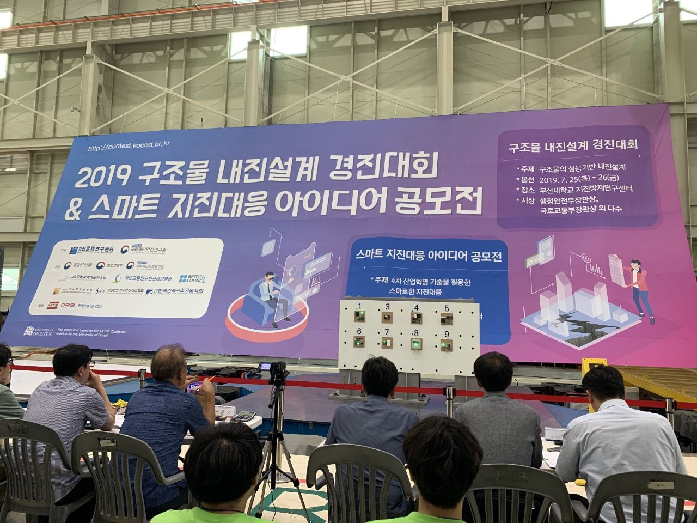

# Seismic Sensing System

This project develops a low-cost IoT seismic sensing system with event triggering and BLE notification.

## Key Results

- **Under $50 per unit** for an ultra-low-power seismic sensor.
- **Two-phase detection:** STA/LTA screening in the time domain, then classification by spectral content to separate earthquake motion from random and sinusoidal vibration.
- **Grand Prize** (Minister of the Interior and Safety Award) at the 2019 Smart Earthquake Response Idea Contest.

## Problem

Low-cost seismic alert systems need to detect earthquake-like events quickly while distinguishing them from random vibration and sinusoidal non-earthquake motions.

## My Role

- Developed real-time event detection and signal classification logic.
- Built a low-cost BLE-based sensing and notification workflow.
- Validated detection performance using shaking-table input signals.

## System / Methods

- STA/LTA-based event triggering.
- Time-domain and frequency-domain signal classification.
- BLE-based notification and alert transmission.
- Low-cost accelerometer and MCU-based sensing.

## Field Deployment

- Validated the system using shaking-table tests with multiple input waveforms.
- Used the project as an early foundation for later IoT sensing and event-triggered monitoring work.

<figure class="project-figure">
  
  <figcaption>BLESeis prototype demonstration at the 2019 Structural Seismic Design Competition and Smart Earthquake Response Idea Contest.</figcaption>
</figure>

## Data / Outputs

- Triggered acceleration records and classification outputs.
- Earthquake/random/sinusoidal motion discrimination results.
- Award-winning prototype for smart earthquake detection and notification.

## Related Publications / Outputs

- BLESeis: Low-Cost IoT Sensor for Smart Earthquake Detection and Notification.


